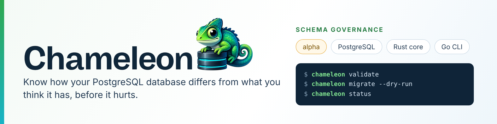

<p align="center">
  <a href="https://github.com/chameleon-db/chameleondb">
    
  </a>
</p>

<p align="center">
  <a href="https://chameleondb.dev">Website</a> ·
  <a href="https://docs.chameleondb.dev">Documentation</a> ·
  <a href="https://github.com/chameleon-db/chameleondb/releases">Releases</a> ·
  <a href="https://chameleondb.dev/discord">Discord</a> ·
  <a href="https://x.com/ChameleonDB">X</a>
</p>

**ChameleonDB** 🦎 helps you keep a reliable relationship between the schema you declare, the changes you make to it, and the real state of your database. It treats the schema as a versioned, hash-checked artifact, records every change in a local audit trail, and lets you restrict who may change it through integrity modes.

It is **not a database engine**. Today it works with **PostgreSQL** only.

> **Alpha.** The project is under active hardening: syntax, APIs and behavior can still change, and it is not recommended for untrusted input or production data yet. Early adopters and feedback are very welcome. See the [security policy](https://github.com/chameleon-db/chameleondb/blob/main/SECURITY.md).

## A first look

Declare your schema in a small, readable language, with no SQL syntax to memorize:

```
entity User {
    id: uuid primary default uuid(),
    email: string unique,
    name: string,
    created_at: timestamp default now(),
    posts: [Post] via author_id,
}

entity Post {
    id: uuid primary default uuid(),
    title: string,
    author_id: uuid,
    author: User,
}
```

Then check it and preview the SQL before anything touches your database:

```bash
chameleon validate
chameleon migrate --dry-run
chameleon status
```

## What works today

- **Schema language and checker:** declare entities, fields and relations in `.cham` files, then parse and type-check them.
- **Migrations for PostgreSQL:** preview the SQL with `--dry-run`, then apply it.
- **Schema Vault:** every registered schema version is stored locally with a hash and its parent version, and tampering outside the tool is detected.
- **Integrity modes:** four modes decide whether schema changes are allowed; moving to a higher privilege asks for a password.
- **Introspection:** generate a schema from an existing PostgreSQL database.
- **Go data-access layer:** a query and mutation builder, as a supporting component.

The guarantees have limits, and we state them: the vault *detects* edits made outside the tool but does not stop someone who can change both the files and their hashes, and integrity modes govern the CLI, not database permissions.

## Where it is going

The near-term goal is to make schema change **observable and reviewable**: know how a database differs from what you think it has, and review each change together with its risk, without rewriting your existing setup first. That is a direction, not a description of today's code; the [product definition](https://github.com/chameleon-db/chameleondb/blob/main/docs/product-definition.md) says what is in and out of scope.

## Repositories

| Repository | What it is |
|---|---|
| [**chameleondb**](https://github.com/chameleon-db/chameleondb) | The project: Rust core, Go runtime and CLI, the `.cham` language, architecture decisions (ADRs) and planning |
| [**chameleon-examples**](https://github.com/chameleon-db/chameleon-examples) | Example projects and demos |
<!-- Add when the repository is public:
| [**vscode-extension**](https://github.com/chameleon-db/vscode-extension) | Syntax highlighting for `.cham` schemas |
-->

## Get involved

- **Try it:** [install](https://github.com/chameleon-db/chameleondb#quick-start) the CLI and follow the [documentation](https://docs.chameleondb.dev).
- **Work on it:** the work is tracked as [issues and a project board](https://github.com/orgs/chameleon-db/projects/1); read [CONTRIBUTING](https://github.com/chameleon-db/chameleondb/blob/main/CONTRIBUTING.md) first.
- **Report a vulnerability:** privately, through the [security advisory form](https://github.com/chameleon-db/chameleondb/security/advisories/new). Please do not open a public issue.

## Why "Chameleon"?

Because real systems survive by **adapting**, not by staying rigid.
